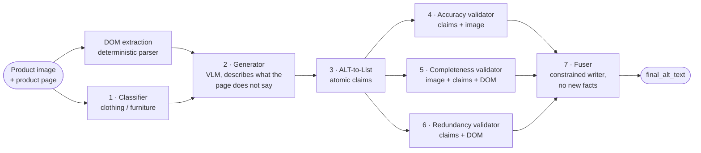

[README.md]
# ViGALT: Visual Gap-Aware Alt Text Generation


**Alt text for e-commerce product images that tells blind and low-vision (BLV) shoppers what the
product page does not.**

On a product page, the title and the attribute list already say that the item is, for example,
a black women's sweater. Alt text that repeats it adds nothing, and a generic image caption spends
words on the model's jeans or the room's decor. ViGALT starts from a different question: not
*"what is in this image?"* but *"what visual information is still missing from this page?"*. It
treats the page text as something the user already knows, and writes alt text that fills the
remaining **visual gap**, checked claim by claim before it is written.

This repository is the public release accompanying the research paper *ViGALT: Visual Gap-Aware
Alt Text Generation for Blind and Low-Vision E-Commerce Shoppers* (AbdulAziz Snoubra and
Abdulkarem Shahen). It contains the full source code, the prompts, and the consolidated
evaluation dataset with the published results for **ViGALT** and the **CAID** baseline
(Mohanbabu and Pavel, ASSETS '24).

## Table of contents

- [Results](#results)
- [Pipeline overview](#pipeline-overview)
- [Repository layout](#repository-layout)
- [Setup](#setup)
- [Quick start: one Amazon URL → full run](#quick-start-one-amazon-url--full-run)
- [Step-by-step guide](#step-by-step-guide)
- [Paper dataset (30 products)](#paper-dataset-30-products)
- [Evaluation metrics](#evaluation-metrics)
- [Notes](#notes)
- [Citation](#citation)
- [License](#license)

## Results

30 paired products from Amazon.fr (15 clothing, 15 furniture). Both systems run on the same
model (GPT-5.6 Luna; the deprecated GPT-4V backend of the public CAID code was replaced), so the
differences come from the pipeline design. Every final text is decomposed into atomic claims and
judged by a stronger model (GPT-5.6 Terra); scores are macro-averaged over the products.

| Metric | ViGALT | CAID | Δ [95% CI] | p (Holm) |
|---|---:|---:|---:|---:|
| Relevancy ↑ | **90.10** | 48.12 | +41.99 [30.9, 53.2] | **< 0.001** |
| Objectivity ↑ | **97.71** | 92.99 | +4.72 [1.2, 8.4] | 0.069 |
| Relevant novelty ↑ | **36.12** | 22.29 | +13.84 [3.1, 24.2] | 0.061 |
| Avoidable redundancy ↓ | **17.76** | 20.55 | −2.80 [−9.2, 3.3] | 0.828 |
| Efficiency ↑ (relevant novel claims per 100 words) | **5.94** | 4.93 | +1.01 [−1.0, 3.0] | 0.828 |

Paired Wilcoxon signed-rank tests with Holm correction across the five metrics. ViGALT scores
higher on every metric; the relevancy gain is significant (rank-biserial r = 0.99), ViGALT being
more relevant on 25 of the 30 products. Objectivity and relevant novelty show consistent trends.

What the difference looks like, on a T-shirt photographed on a model:

> **CAID:** A woman wears a black V-neck T-shirt with a white heart outline, layered necklaces,
> and bracelets, paired with distressed blue denim shorts. A patterned shoulder bag hangs at her
> side.
>
> **ViGALT:** A T-shirt is shown worn on a person. It has a V-neckline, a straight body extending
> to the upper hips, and short sleeves ending above the elbows, with an irregular white outlined
> heart on the upper right chest.

**Validator ablation.** Re-running only the fuser with one validator channel removed (90 runs)
shows that each validator contributes something distinct: the completeness validator added 48
claims across 27 of the 30 products, all lost without it; the accuracy validator made 8
corrections and 1 deletion across 7 products; without the redundancy validator, more avoidable
repetition of the page text is kept in 14 products. Details in
[`docs/validator_ablation_report.md`](docs/validator_ablation_report.md).

The per-product results behind these numbers are in [`evaluation_dataset/`](evaluation_dataset)
and can be checked without re-running anything (see [Verify published metrics](#verify-published-metrics)).

## Pipeline overview



- **DOM extraction** turns the product page into structured JSON (title, brand, description,
  feature bullets, product details): what the shopper can already learn from the page. It is a
  deterministic parser; every following step is performed by a language model.
- **Classifier** assigns every product to **CLOTHING** or **FURNITURE**, so that the next prompts
  focus on the attributes that matter for that category.
- **Generator** receives the image and the page context and is instructed to describe the visually
  meaningful details that the page does not already cover.
- **ALT-to-List** decomposes the candidate text into atomic, independently checkable claims, so
  that validation works on single facts rather than on multi-fact sentences.
- **Validators** (stages 4 to 6) run in parallel on the same claims: the accuracy validator flags
  claims the image does not support, the completeness validator lists important visible details
  missing from both the text and the page, and the redundancy validator labels each claim
  `NOVEL`, `UNAVOIDABLE_REPETITION` or `AVOIDABLE_REDUNDANCY` with respect to the page.
- **Fuser** applies the validators' verdicts (removes or corrects rejected content, adds validated
  missing details) and writes the concise final alt text. It introduces no new facts of its own.

All other stages are sequential. See [docs/pipeline_architecture.md](docs/pipeline_architecture.md)
for the full specification.

## Repository layout

```
.
├── src/viglat/            Python package (pipeline + evaluators)
├── prompts/               Stage prompts and evaluation rubrics
├── evaluation_dataset/    Published per-image results (30 folders + summary.json)
├── docs/                  Architecture documentation + validator ablation report
├── scripts/               Dataset maintenance and paper statistics scripts
├── output/                Generated runs (created when you execute the pipeline)
├── pyproject.toml         Package metadata
├── requirements.txt       Dependencies
└── .env.example           API key template
```

The Python package is named `viglat`; all commands below are run as `python -m viglat.<command>`.

### `src/viglat/` structure

```
src/viglat/
├── paths.py                 Stable project-root resolution
├── pipeline/                7-stage runner, utils, types
├── backend/                 OpenAI client, config, JSON schemas
├── extraction/              Amazon DOM scraper
├── evaluation/              Relevancy, redundancy, objectivity, efficiency evaluators
├── cli/                     extract_dom, run_from_url, build_dataset, combine_claims
└── *.py shims               Backward-compatible entry points (e.g. pipeline via package)
```

| Group | Location |
|---|---|
| Pipeline core | `pipeline/runner.py`, `pipeline/utils.py`, `pipeline/types.py` |
| Backend | `backend/openai.py`, `backend/config.py`, `backend/schemas.py` |
| DOM extraction | `cli/extract_dom.py`, `extraction/amazon.py` |
| Orchestration | `cli/run_from_url.py` |
| Evaluators | `evaluation/relevancy.py`, `redundancy.py`, `objectivity.py`, `efficiency.py`, `alt_to_list.py` |
| Dataset tools | `cli/build_dataset.py`, `cli/combine_claims.py` |

All documented `python -m viglat.*` commands work through thin shims at the package root.

## Setup

Python 3.10 or newer, and an [OpenAI API key](https://platform.openai.com/api-keys).

```bash
python -m venv .venv
.venv\Scripts\activate          # Windows
# source .venv/bin/activate     # macOS/Linux
pip install -r requirements.txt
pip install -e .
```

Set your OpenAI API key (required for all LLM stages). Either copy `.env.example` to `.env` and
fill in your key, or export it in the shell.

Windows (PowerShell):

```powershell
# Option A: .env file (recommended)
copy .env.example .env
# Edit .env and set OPENAI_API_KEY=sk-...

# Option B: environment variable
$env:OPENAI_API_KEY = "sk-..."
```

macOS / Linux:

```bash
# Option A: .env file (recommended)
cp .env.example .env
# Edit .env and set OPENAI_API_KEY=sk-...

# Option B: environment variable
export OPENAI_API_KEY=sk-...
```

The `.env` file in the project root is loaded automatically when you run any `python -m viglat.*`
command. It is listed in `.gitignore` and must never be committed.

**Models.** The default pipeline model is **`gpt-5.6-luna`**; the evaluation stages (relevancy,
redundancy, objectivity) use **`gpt-5.6-terra`**. Both are configured in
[`src/viglat/backend/config.py`](src/viglat/backend/config.py), together with the sampling
settings. Override them with `--single-model` or `--model` on any command.

---

## Quick start: one Amazon URL → full run

Runs DOM extraction, alt-text generation, claim export, and all four evaluation metrics:

```bash
python -m viglat.run_from_url --url "https://www.amazon.fr/dp/B077XM3DV5"
```

Each run is written to a numbered folder with fixed filenames:

```
output/runs/
  1/
    dom.json
    image.jpg
    meta.json
    pipeline.json
    claims.json
    relevancy.json
    redundancy.json
    objectivity.json
    efficiency.json
  2/
    ...
```

The next free run number is chosen automatically (`1`, then `2`, …).

Options:

```bash
python -m viglat.run_from_url --url "..." --run-id 5           # use output/runs/5/
python -m viglat.run_from_url --url "..." --work-dir output/runs/custom
python -m viglat.run_from_url --html saved_page.html --work-dir output/runs/3
python -m viglat.run_from_url --url "..." --skip-eval          # pipeline only
python -m viglat.run_from_url --url "..." --single-model gpt-5.6-luna
```

---

## Step-by-step guide

The quick start chains the steps below. They can also be run one by one, for example to inspect
or re-run a single stage.

### Step 1 — Extract product DOM + image

Build a product JSON from an Amazon URL. Downloads the main product image into the same folder.

```bash
python -m viglat.extract_dom \
  --url "https://www.amazon.fr/dp/B077XM3DV5" \
  --output-dir output/runs/1
```

Creates:

- `output/runs/1/dom.json`: title, brand, description, feature bullets, product details, `main_image`
- `output/runs/1/image.jpg`: downloaded product image (single file, no duplicate)
- `output/runs/1/meta.json`: run id, ASIN, source URL

If Amazon blocks automated requests, save the page HTML in your browser and parse it locally:

```bash
python -m viglat.extract_dom --html saved_page.html --output-dir output/runs/1
```

You can also use a product JSON from the paper dataset: `evaluation_dataset/1/dom.json` (each
folder `1/` … `30/` contains the metadata of one product).

### Step 2 — Generate alt text (7 pipeline stages)

One command runs all generation stages via OpenAI:

| Order | Stage | Prompt | Input |
|---|---|---|---|
| 1 | Classifier | `prompts/classifier.txt` | image + surrounding text |
| 2 | Generator | `prompts/clothing_generator.txt` or `furniture_generator.txt` | image + surrounding text |
| 3 | Claim extraction | `prompts/alt_to_list.txt` | generated alt text |
| 4 | Accuracy validator | `prompts/accuracy_validator.txt` | image + claims |
| 5 | Completeness validator | `prompts/completeness_validator.txt` | image + claims |
| 6 | Redundancy validator | `prompts/redundancy_validator.txt` | image + claims |
| 7 | Fuser | `prompts/fuser.txt` | validator outputs |

```bash
python -m viglat.pipeline --product output/runs/1/dom.json --output output/runs/1/pipeline.json
```

Or with a paper-dataset product:

```bash
python -m viglat.pipeline --product evaluation_dataset/1/dom.json
```

Output: the file given with `--output`, by default `output/<stem>_pipeline.json`, with
`final_alt_text` and the per-stage results.

Further options: `--from-stage <stage>` resumes from a stage, reusing the earlier stage outputs
from the saved pipeline JSON; `--timeout` (seconds per stage, default 300) and `--delay` (seconds
between stages, default 3) control the API calls.

### Step 3 — Extract claims (evaluation format)

The pipeline already runs claim extraction inline (stage 3). This step re-extracts claims into the
batch format used by the evaluators:

```bash
python -m viglat.alt_to_list_batch \
  --source pipeline \
  --pipeline output/B077XM3DV5_pipeline.json \
  --output-dir output/runs/B077XM3DV5/final_alt_claim_lists
```

Output: `output/runs/B077XM3DV5/final_alt_claim_lists/B077XM3DV5_claims.json`

### Step 4 — Relevancy evaluation

```bash
python -m viglat.relevancy_evaluator_batch \
  --algorithm ViGALT \
  --vigalt-claims-dir output/runs/B077XM3DV5/final_alt_claim_lists \
  --products-dir output/runs/B077XM3DV5 \
  --images-dir output/runs/B077XM3DV5 \
  --output output/runs/B077XM3DV5/relevancy_evaluations.json
```

Prompt: `prompts/evaluators/relevancy.txt`

### Step 5 — Redundancy evaluation

```bash
python -m viglat.redundancy_evaluator_batch \
  --algorithm ViGALT \
  --relevancy-input output/runs/B077XM3DV5/relevancy_evaluations.json \
  --products-dir output/runs/B077XM3DV5 \
  --output output/runs/B077XM3DV5/redundancy_evaluations.json
```

Prompt: `prompts/evaluators/redundancy.txt`

### Step 6 — Objectivity evaluation

```bash
python -m viglat.objectivity_evaluator_batch \
  --algorithm ViGALT \
  --relevancy-input output/runs/B077XM3DV5/relevancy_evaluations.json \
  --products-dir output/runs/B077XM3DV5 \
  --images-dir output/runs/B077XM3DV5 \
  --output output/runs/B077XM3DV5/objectivity_evaluations.json
```

Prompt: `prompts/evaluators/objectivity.txt`

### Step 7 — Efficiency evaluation

Deterministic metric (no LLM): `(relevant_novel_claims / ALT word count) × 100`

```bash
python -m viglat.efficiency_evaluator_batch \
  --algorithm ViGALT \
  --redundancy-input output/runs/B077XM3DV5/redundancy_evaluations.json \
  --relevancy-input output/runs/B077XM3DV5/relevancy_evaluations.json \
  --output output/runs/B077XM3DV5/efficiency_evaluations.json
```

---

## Paper dataset (30 products)

### What is included

The `evaluation_dataset/` folder contains everything needed to **verify** the paper numbers:

| File per folder (`1/` … `30/`) | Contents |
|---|---|
| `dom.json` | Product metadata (title, brand, features, `main_image` URL, …) |
| `*.jpg` | The product image |
| `alt_text_and_claims.txt` | ViGALT and CAID alt text + plain claims |
| `evaluation.json` | Relevancy, redundancy, objectivity, efficiency metrics |
| `pipeline/` | Pre-fusion pipeline outputs: `generated_alt_text.txt`, `claims.json` and the three validator JSON files |
| `ablations/` | Validator ablation runs: `no_accuracy/`, `no_completeness/`, `no_redundancy/` |

The top-level `evaluation_dataset/summary.json` holds the macro-averaged metrics across all 30
products (each product weighted equally); `ablation_summary.json` holds the ablation statistics.

- **30 products:** folders `1/` … `30/` (15 clothing, 15 furniture)
- Product JSONs live at `evaluation_dataset/N/dom.json`, not in a separate `data/` folder
- Images are referenced by URL in `dom.json`; the pipeline downloads them on first run

### Re-run pipeline on a paper product

```bash
python -m viglat.pipeline --product evaluation_dataset/1/dom.json
python -m viglat.pipeline --product evaluation_dataset/1/dom.json --single-model gpt-5.6-luna
```

To process all 30 products, run the pipeline once per folder (or use a shell loop over
`evaluation_dataset/*/dom.json`).

### Verify published metrics

Compare your outputs to the pre-computed files in `evaluation_dataset/N/evaluation.json` and the
averages in `evaluation_dataset/summary.json`. No re-run is required to check the paper numbers.

Recompute relevancy scores from the existing R/S/V claim labels (same formula as
`prompts/evaluators/relevancy.txt`) and refresh the summaries:

```bash
python -m viglat.refresh_relevancy_metrics
```

Regenerate the paper figures (matplotlib; requires `pip install -e ".[viz]"`):

```bash
python -m viglat.generate_paper_figures
```

### Validator ablation (fusion stage)

Run fusion without one validator input (requires the `evaluation_dataset/N/pipeline/` artifacts):

```bash
python -m viglat.run_validator_ablation --products 1-30 --skip-existing
```

Regenerate the ablation study section (for insertion into your main report) and the
machine-readable aggregates:

```bash
python -m viglat.build_ablation_report
```

Outputs:

- [`docs/validator_ablation_report.md`](docs/validator_ablation_report.md): fusion-stage ablation only (setup, results, illustrative cases)
- [`evaluation_dataset/ablation_summary.json`](evaluation_dataset/ablation_summary.json): reproducible summary statistics
- Per-product raw ablation artifacts: `evaluation_dataset/N/ablations/{no_accuracy,no_completeness,no_redundancy}/`
- Pre-fusion pipeline inputs (for ablation reruns): `evaluation_dataset/N/pipeline/` (`generated_alt_text.txt`, `claims.json`, three validator JSON files)

---

## Evaluation metrics

Every final alt text, from both systems, is decomposed into atomic claims, and each claim is
labelled by the judge model. Scores are computed per product and macro-averaged.

| Metric | Description |
|---|---|
| Relevancy | Each claim is classified as **R** (relevant to the product), **S** (justified staging) or **V** (off-focus violation), then scored with `100 × (R + 0.5·S) / (R + S + 2·V)` (see `prompts/evaluators/relevancy.txt`). Off-focus detail is penalised more strongly than in a plain relevant-claim fraction; clothing listings have S = 0 by rubric. `evaluation.json` stores `relevancy_score` (0–100); `summary.json` stores `avg_relevancy_score` on a 0–1 scale (macro mean over 30 products). |
| Redundancy | Novel vs. avoidable repetition relative to the product DOM. **Relevant novelty** is the share of claims that are both new with respect to the DOM and relevant; **avoidable redundancy** (lower is better) is the share of claims that needlessly repeat the page. |
| Objectivity | Objective vs. subjective claim labels: the share of observable, non-marketing claims |
| Efficiency | `(relevant_novel_claims / ALT word count) × 100`: relevant new information per 100 words |

Unavoidable repetition (a short anchor such as "the hoodie" in "the hoodie has a small logo on
the left chest", needed to make a new visual detail understandable) is not penalised.

## Notes

- Amazon DOM extraction may be blocked by bot detection; use `--html` with a saved page when
  needed. Scraping is your responsibility under Amazon's terms of service.
- Re-running the pipeline produces new alt texts; LLM outputs vary. Use `evaluation_dataset/` to
  verify the published paper numbers.
- If you see `viglat.egg-info/` under `src/` after `pip install -e .`, that is a local build
  artifact (gitignored).
- The current scope is two product families (clothing and furniture) from one retailer, and all
  judgments are automated and rubric-based. A user study with BLV participants, an independent
  factuality audit and more categories and retailers are the next steps described in the paper.

## Citation

If you use this code or dataset in your research, please cite:

```bibtex
@misc{snoubra2026vigalt,
  title  = {{ViGALT}: Visual Gap-Aware Alt Text Generation for Blind and Low-Vision E-Commerce Shoppers},
  author = {Snoubra, AbdulAziz and Shahen, Abdulkarem},
  year   = {2026},
  note   = {Code and data: https://github.com/Abdulkarem-SHAHEN/ViGALT}
}
```

## License

MIT — see [LICENSE](LICENSE).
